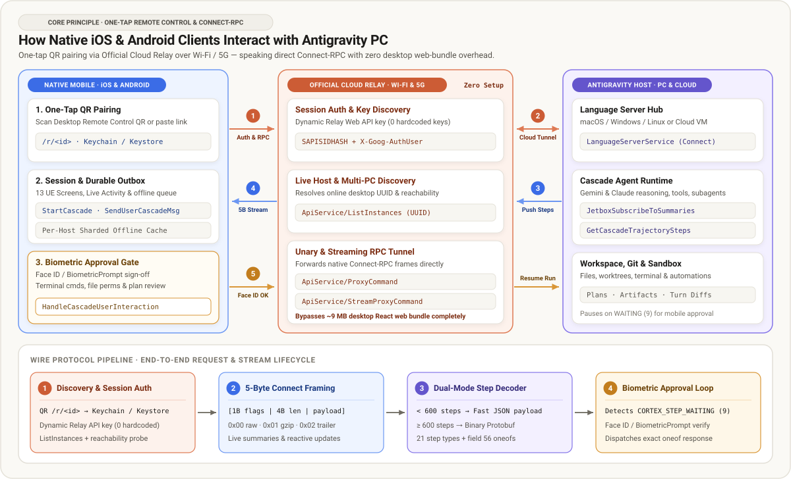

<div align="center">

# AG Orbit (`iOSAntigravity`)

**Native iOS & Android Mobile Client for Google Antigravity Remote Control**

[](#4-overall-architecture)
[](#4-overall-architecture)
[](#3-core-principle--how-it-interacts-with-antigravity)
[](LICENSE)

</div>

---

## 1. What Is This Project?

**AG Orbit (`iOSAntigravity`)** is an open-source **native iOS and Android client** for **Google Antigravity**, enabling **one-tap pairing and real-time remote control** of your Antigravity PC / Desktop and Cloud agent sessions straight from your phone. Built with 100% native mobile UI (Swift 6 SwiftUI/UIKit on iOS and Kotlin Jetpack Compose on Android) backed by a Kotlin Multiplatform (KMP) protocol core, it speaks directly to Antigravity's `LanguageServerService` with zero web-bundle overhead.

---

## 2. Why I Built This

With the recent leap in **Gemini**'s reasoning and coding capabilities, Antigravity quickly became my daily driver for software engineering. I love using its **Remote Control** workflow to launch tasks, monitor progress, review implementation plans, and approve terminal commands while away from my desk — yet I was surprised to discover that Antigravity had **no official native mobile app** for iOS or Android. Relying on a desktop web wrapper on a phone felt sluggish and disconnected from real mobile ergonomics (Face ID / biometric approvals, Dynamic Island & Live Activities, offline resilience, and fluid native gestures), so I built this native app from the ground up.

---

## 3. Core Principle — How It Interacts with Antigravity

Rather than embedding a mobile browser or wrapping the ~9 MB desktop React bundle, the client speaks Antigravity's native **Connect-RPC wire protocol** (`exa.language_server_pb.LanguageServerService`) directly over the **Official Cloud Relay** — working seamlessly across Wi-Fi and 5G with zero desktop scripts or network configuration:

<p align="center">
  <picture>
    <source media="(prefers-color-scheme: dark)" srcset="docs/images/core-principle-dark.svg">
    <source media="(prefers-color-scheme: light)" srcset="docs/images/core-principle-light.svg">
    
  </picture>
</p>

### One-Tap Pairing & Cloud Relay Tunnel

1. **Scan the Desktop Remote Control QR**: Open **Remote Control** in Antigravity Desktop (`https://antigravity.google.com/r/<instance-id>`) and scan the QR code (or paste the link) on your phone.
2. **One-Time Sign-In & Live Host Discovery**: Sign in once with your Google account — credentials stay strictly inside **iOS Keychain / Android Keystore**. The client dynamically discovers the Relay Web API key (zero hardcoded keys in source), signs requests with `SAPISIDHASH`, and calls `devtools_jetski_boq_api_proto.ApiService/ListInstances` (auto-probing multi-account `X-Goog-AuthUser` + live reachability) to resolve your online PC host UUID.
3. **Direct Connect-RPC Tunneling**: All unary and streaming `LanguageServerService` RPCs tunnel transparently through `ApiService/ProxyCommand` and `ApiService/StreamProxyCommand`, completely bypassing the ~9 MB desktop web bundle.

### Wire Protocol & Interaction Lifecycle

1. **5-Byte Connect Streaming Envelope**: Real-time push streams (`JetboxSubscribeToSummaries`, `StreamCascadeReactiveUpdates`, `ProjectUpdatesStream`) frame every chunk with a 5-byte prefix (`[1B flags (0x00 raw / 0x01 gzip / 0x02 end-trailer) | 4B big-endian length | payload]`).
2. **Dual-Mode Trajectory Decoding (`< 600` JSON / `≥ 600` Binary Protobuf)**: Upstream JSON responses truncate trajectories above 600 steps. The client seamlessly switches to raw binary Protobuf (`Content-Type: application/proto`) at `≥ 600` steps via `ProtobufStepDecoder` / `ProtobufStepCodec`, decoding all 21 `CORTEX_STEP_TYPE_*` step kinds and field 56 (`requestedInteraction`) without data loss.
3. **Biometric Approval Gate & Durable Outbox**: Whenever a remote PC agent pauses in `CORTEX_STEP_STATUS_WAITING (9)` (shell command execution, file permission, plan review, or multi-step structured question), the app surfaces an inline amber approval card and Dynamic Island / notification action gated by **Face ID / BiometricPrompt**, then dispatches the exact matching oneof via `HandleCascadeUserInteraction`. Outgoing prompts (`StartCascade`, `SendUserCascadeMessage`) queue locally in a per-host **Durable Outbox** for instant optimistic UI and automatic replay upon reconnection.

---

## 4. Overall Architecture

The codebase follows a strict **three-layer architecture** designed to keep platform UI 100% native while maximizing shared protocol, model, and rendering logic across iOS and Android via **Kotlin Multiplatform (KMP)**.

<p align="center">
  <picture>
    <source media="(prefers-color-scheme: dark)" srcset="docs/images/architecture-dark.svg">
    <source media="(prefers-color-scheme: light)" srcset="docs/images/architecture-light.svg">
    
  </picture>
</p>

### Layer Breakdown

| Layer | Responsibility | Key Modules & Paths |
| :--- | :--- | :--- |
| **Layer 1 · Application Layer** | **100% Native UI, Navigation & OS Extensions.** Owns all visual surfaces, gestures, haptics, and platform extensions while observing state unidirectionally. | • **iOS (`apps/ios/App/`, `apps/ios/SharedUI/`, `apps/ios/Extensions/`)**: Swift 6 + SwiftUI/UIKit implementing all 13 UE screens (`UE01`–`UE13`), Floating Liquid Glass shell, `KmpCoreEngineAdapter` SKIE bridge, Dynamic Island & Lock Screen Live Activity, Share Extension, Face ID, and Voice Input.<br>• **Android (`apps/android/` · Planned)**: Native Kotlin / Jetpack Compose Material 3 UI, `BiometricPrompt`, and live progress notifications consuming the KMP `shared/` modules directly.<br>• **Design System**: Matte Obsidian (`#090A0D`), Periwinkle CTA (`#8EB4FF`), Face ID Amber (`#EBB365`), and cross-platform `SemanticIcon` tokens. |
| **Layer 2 · Capability Layer** | **Domain Orchestration, Offline Continuity & Universal Rendering.** Coordinates multi-host state, offline storage, streaming rich content, and OS services. | • **Shared Domain Orchestration (`shared/core-domain/`)**: `StateFlow`-backed `ConnectionDomainStore`, `ConversationSyncStore`, `CascadeChatDomainStore`, `DurableOutbox`, and `AntigravityCoreCoordinator` exported to iOS via SKIE (`async/await` & `AsyncSequence`) and consumed natively on Android.<br>• **iOS Session Adapter & Offline Store (`apps/ios/Packages/AntigravityData/`)**: `@Observable` `AntigravitySessionStore` delegating live connection, sync, step loading, and PC interactions via pure-Swift `AntigravityKmpEnginePort` + per-host sharded `LocalProjectionStore`.<br>• **Universal Rendering & Review (`shared/core-markdown/`, `apps/ios/App/Views/Cascade/`, `apps/ios/App/ViewControllers/Inspector/`)**: Streaming Markdown AST, TextKit code pills, Mermaid diagrams, `<agent-embed>` previews, Implementation Plan inline comments, and line-level Turn Diff review.<br>• **Approvals & OS Coordinators (`apps/ios/App/Services/`)**: Biometric interaction gate, structured Q&A wizard, `LiveActivityCoordinator`, `NotificationCoordinator`, and `VoiceInputManager`. |
| **Layer 3 · Core Layer** | **Cross-Platform Shared Core, Wire Protocol & Platform Ports.** Pure, UI-free protocol and model engine compiled for both iOS and Android. | • **KMP Shared Core (`shared/`)**: `:shared:core-model` (canonical models), `:shared:core-protocol` (Ktor OkHttp/Darwin + SHA-256 TLS pinning, 5B Connect framing, Binary Protobuf codec, `SAPISIDHASH` Cloud Relay, `InteractionBuilder`), `:shared:core-markdown` (AST parser), `:shared:core-domain` (StateFlow stores), and `:shared:umbrella` (SKIE-enhanced static `AntigravityShared.xcframework` + JVM/Android).<br>• **Extension-Safe Pure Swift 6 Data Package (`apps/ios/Packages/AntigravityData/`)**: Zero-UIKit / zero-KMP-binary Swift package keeping iOS WidgetKit & Share extensions safely under the 30 MB memory ceiling.<br>• **Platform Ports (`PlatformPorts`)**: `expect`/`actual` & protocol contracts abstracting `SecretStore` (Keychain / Keystore), `NetworkReachabilityMonitoring` (`NWPathMonitor` / `ConnectivityManager`), `PowerStateProviding`, `KeyValuePreferencesStore`, and Biometrics. |

### Repository Layout (KMP Monorepo)

```text
.
├── apps/
│   ├── ios/                        # Native Swift 6 iOS client
│   │   ├── App/                    #   13 UE screens, shell, KMP SKIE bridge (Bridge/), pairing, services
│   │   ├── Extensions/             #   WidgetKit Dynamic Island / Live Activity & Share Extension
│   │   ├── SharedUI/               #   iOS-only Design System tokens, Liquid Glass & Live Activity models
│   │   └── Packages/
│   │       └── AntigravityData/    #   Pure Swift 6 store, port protocols & extension-safe RPC package
│   └── android/                    # Native Android Jetpack Compose client (Phase 3 · consumes shared/)
├── shared/                         # Kotlin Multiplatform (KMP) shared core for iOS & Android
│   ├── core-model/                 #   Canonical Cascade, Workspace, Artifact & Interaction models
│   ├── core-protocol/              #   Ktor (OkHttp/Darwin), TLS Pinning, 5B Connect, Binary Protobuf & Cloud Relay
│   ├── core-markdown/              #   Cross-platform streaming Markdown AST parser
│   ├── core-domain/                #   StateFlow Connection, ConversationSync, CascadeChat & DurableOutbox stores
│   └── umbrella/                   #   SKIE facade exporting AntigravityShared.xcframework & JVM/Android
├── tests/
│   └── ios-ui/                     # Native iOS XCUITest interactive tap & flow suite (AntigravityUITests)
├── project.yml                     # Root XcodeGen spec assembling apps/ios/*, tests/ios-ui & AntigravityShared.xcframework
├── docs/                           # Architecture SVG diagrams & upstream documentation snapshots
├── scripts/                        # Unified verify CLI, icon renderer & upstream doc-sync automation
├── specs/                          # Normative ESDD product, protocol & E2E test specifications
└── verification/                   # 4-gate ESDD verifier, mock LanguageServer & Simulator E2E runner
```

---

## 5. How to Contribute

Contributions of all kinds are welcome — from Android Jetpack Compose screens and KMP core parity to upstream protocol features, bug fixes, accessibility improvements, and documentation!

### Prerequisites

- **iOS Development**: macOS with Xcode 16+ (Swift 6) and [XcodeGen](https://github.com/yonaskolb/XcodeGen).
- **KMP / Android Shared Core**: JDK 21 and Gradle (`./gradlew` included).
- **Protocol & ESDD Verification**: Python 3.10+ (zero external server dependencies for mock RPC tests).

### Building & Opening in Xcode (macOS)

`iOSAntigravity.xcodeproj` and `AntigravityShared.xcframework` are generated locally and excluded from Git. After cloning or running `git pull`, always sync the Xcode project before building:

```bash
# 1. Build/refresh KMP XCFramework + regenerate iOSAntigravity.xcodeproj and open Xcode
bash scripts/sync-xcode.sh --open

# (Optional) Install git hooks so future `git pull` / branch switches auto-sync Xcode
bash scripts/sync-xcode.sh --install-hooks

# (Optional) Wipe stale pre-monorepo .xcodeproj & DerivedData, or build pure-Swift without JDK
bash scripts/sync-xcode.sh --clean --open
bash scripts/sync-xcode.sh --swift-only --open

# Build, sign & install directly onto a connected physical iPhone
bash scripts/install-on-iphone.sh
```

### Local Verification CLI (Human & Coding-Agent Friendly)

Use the single stateless [`scripts/verify.py`](scripts/verify.py) CLI from any directory — it auto-detects available toolchains on Linux/macOS, suppresses noisy HTTP logs, keeps `git status` clean, and supports machine-readable `--json` output:

```bash
# Fast default gates: Spec-DAG + live mock Connect-RPC + v2.33 + 3-version compat matrix (~7s)
./scripts/verify.py

# Impact-scoped mode: fast gates + change-scoped ESDD (`e2e_impact_planner`)
./scripts/verify.py --auto

# Full available suite: adds full Chromium ESDD 16-TC/@3x audit, KMP JVM tests & Swift 6 XCTest
./scripts/verify.py --full

# Machine-readable JSON report (ideal for coding agents & CI tooling)
./scripts/verify.py --json

# Run specific suite(s) only: spec | rpc | v233 | compat | esdd | kmp | swift | bridge | sim
./scripts/verify.py --suite rpc,compat,kmp
./scripts/verify.py --list

# Assemble SKIE iOS XCFramework & run Swift 6 strict-concurrency XCTest directly (macOS)
./gradlew :shared:umbrella:assembleAntigravitySharedDebugXCFramework --no-daemon
swift test --package-path apps/ios/Packages/AntigravityData
```

### Pull Request Workflow

1. **Fork** the repository and create a clean branch off `main` (`feat/<topic>`, `fix/<topic>`, or `docs/<topic>`).
2. Follow the architectural boundaries and ESDD guidelines documented in [`AGENTS.md`](AGENTS.md) and [`specs/`](specs/).
3. Ensure zero hardcoded secrets/API keys and verify all local gates pass.
4. Open a **Pull Request** targeting `main` with a concise summary and verification checklist. GitHub Actions automatically runs impact-scoped verification on PRs (`macos-xcode-verify.yml` skips macOS entirely on pure documentation/Android/KMP-only changes and runs only impacted gates/screens; `kmp-verify.yml` runs when `shared/**` changes; releases always enforce 100% full E2E).

### Great Areas to Help Out

- **Android Native UI**: Building out the native Jetpack Compose screens (`UE01`–`UE13`) and foreground progress notifications on top of `shared/`.
- **KMP Shared Core Parity**: Expanding `:shared:core-protocol` and domain stores for full iOS + Android feature parity.
- **Protocol & Upstream Sync**: Supporting newly introduced `LanguageServerService` step types, artifact formats, and interaction gates.
- **UX, Localization & Testing**: Improving accessibility, localization, and real-device edge-case coverage.

---

## 6. License & Declarations

### Open-Source License

This project is open-sourced under the **[MIT License](LICENSE)**. You are free to use, modify, and distribute this software in accordance with the terms of the MIT License.

### Original Creation & Copyright Declaration

- **Copyright © 2026 iOSAntigravity Contributors.**
- All client source code, multiplatform architecture, protocol implementations, companion scripts, diagrams, and the original 7-segment Orbital Terminal app icon (**`AG Orbit`**, [`scripts/assets/ag-orbit-original-icon.svg`](scripts/assets/ag-orbit-original-icon.svg)) are **100% original works** authored by the creator and contributors of this repository.
- This repository contains **zero** official Google graphic assets, icons, or proprietary brand files, designed for full compliance with Apple App Store Review Guidelines 5.2.2 and 4.1.

### Unofficial Companion & Trademark Disclaimer

- **AG Orbit (`iOSAntigravity`)** is an independent, unofficial third-party companion client. It is **not** affiliated with, endorsed by, sponsored by, or officially connected to **Google LLC**.
- *"Google"*, *"Gemini"*, *"Google Antigravity"*, and *"Antigravity"* are trademarks of **Google LLC**, referenced solely under nominative fair use to describe protocol interoperability with user-managed Antigravity environments (see [`NOTICE`](NOTICE)).
