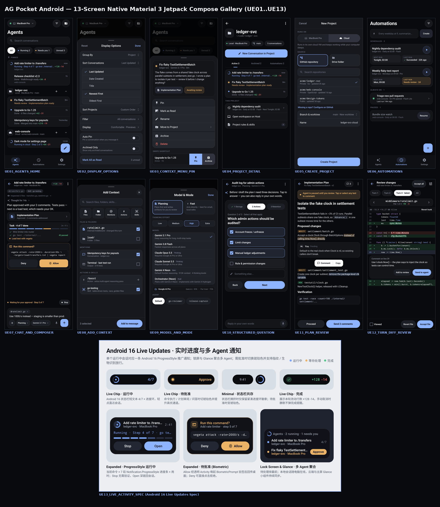

# Platform Support & Feature Status (`AG Pocket` / `PocketAntigravity`)

> **Last updated**: Post-PR `#39` (Native iOS + Native Android Jetpack Compose + Full KMP Shared Core Parity on `main`).
>
> This document summarizes **which platforms are supported**, **what capabilities are implemented on each platform**, **what is automatically verified in CI**, and **what remains on the roadmap**.

### Status Legend

| Badge | Meaning |
| :---: | :--- |
| ✅ | **Implemented & CI-Verified** — Built, wired end-to-end, and validated by automated unit/E2E/visual tests in GitHub Actions. |
| 🚧 | **Core & UI Ready / Hardware Wiring Next** — Compose UI, KMP state, and protocol transport are implemented; final on-device OS hardware hook (e.g., CameraX / WebView OAuth sheet / live mic capture) is the next follow-up. |
| 🧭 | **Planned** — Not yet started; tracked on the roadmap. |

---

## 1. Supported Platforms & Targets at a Glance

| Target | Min / Target OS | Tech Stack | Status | Key Highlights |
| :--- | :--- | :--- | :---: | :--- |
| **iOS App** (`apps/ios/`) | **iOS 18.0+** (Xcode 16+ / Swift 6) | SwiftUI + UIKit + SKIE (`AntigravityShared.xcframework`) + Pure-Swift `AntigravityData` | ✅ | All 13 UE screens (`UE01`–`UE13`), Floating Liquid Glass shell, Dynamic Island & Lock Screen Live Activities, Share Extension (<30 MB), Face ID approval gate, live Camera QR scanner, WebView Google Cloud Relay sign-in, native `SFSpeechRecognizer` voice input, Frame-0 instant launch. |
| **Android App** (`apps/android/`) | **Android 10–16** (`minSdk 29`, `compileSdk 36`, `targetSdk 36`) | Kotlin 2.1.21 + Jetpack Compose (`BOM 2025.10.00`) + Material 3 (`1.4.0`) + Adaptive `NavigationSuiteScaffold` | ✅ | 3-module architecture (`core-ui`, `core-platform`, `app`) consuming KMP `shared/` directly. All 13 UE screens (`UE01`–`UE13`) adapted idiomatically to Material 3, Android 16 `NotificationCompat.ProgressStyle` Live Updates + Android 10–15 Foreground Service fallback, Jetpack Glance home widget, `BiometricPrompt`, Tink + Keystore encryption, Material You Dynamic Color opt-in, native Share receiver. |
| **KMP Shared Core** (`shared/`) | JVM 21 · Android API 29+ · iOS 18+ (`arm64` / Simulator) | Kotlin Multiplatform (`core-model`, `core-protocol`, `core-markdown`, `core-domain`, `umbrella`) + Ktor + SKIE | ✅ | Single shared source of truth for Connect-RPC (5-byte streaming), Binary-first Protobuf + adaptive JSON fallback, Cloud Relay (`SAPISIDHASH`), 7 `StateFlow` domain stores, `DurableOutbox`, `HostCapabilityRegistry`, `ProtocolCompatibilityEngine`, streaming Markdown AST, and deterministic ESDD fixtures. |
| **Antigravity Host Targets** | Desktop PC · Antigravity Cloud (`v1/...`) · Optional LAN Companion Bridge | Official Cloud Relay (`ApiService/ProxyCommand` & `StreamProxyCommand`) · Direct LAN / Tailscale TLS | ✅ | Bidirectional compatibility across older & newer Desktop versions (`v2.20` .. `v2.33+` and future versions) via per-host capability negotiation, negative caching, resilient enums, and automatic unknown-field stripping/downgrading. |

---

## 2. Detailed Feature Matrix (iOS vs Android vs KMP Shared Core)

### 2.1 Core Screens & Navigation (`UE01`–`UE13`)

Every screen follows the normative ESDD specs ([`specs/`](../specs/) and [`specs/android/`](../specs/android/)) while using platform-idiomatic navigation and visual design (iOS HIG / Floating Liquid Glass on iOS; Material Design 3 Tonal Elevation / `NavigationSuiteScaffold` on Android).

| Screen ID | Capability | iOS (`apps/ios/`) | Android (`apps/android/`) | Shared KMP State (`shared/`) |
| :--- | :--- | :---: | :---: | :--- |
| **`UE01`** | **Agents Home** — Multi-host conversation feed, Cloud/Local badges, running pulse, inbox filter, pull-to-refresh, compose FAB | ✅ `AgentsHomeViewController` | ✅ `AgentsHomeScreen` | ✅ `ConversationSyncStore` |
| **`UE02`** | **Display Options** — Group by Workspace/Status/Date, sort order, archived/cloud filters | ✅ `DisplayOptionsSheetView` | ✅ `DisplayOptionsSheet` | ✅ `ConversationSyncStore` |
| **`UE03`** | **Conversation Context Menu** — Pin, Rename, Mark Unread, Export Summary, Archive, Delete | ✅ `ConversationContextPreviewMenu` | ✅ `ConversationContextSheet` | ✅ `ConversationSyncStore` |
| **`UE04`** | **Project / Workspace Detail** — Repo header, branch status, workspace conversations, quick new task | ✅ `ProjectDetailViewController` | ✅ `ProjectDetailScreen` | ✅ `WorkspaceAndAutomationStore` |
| **`UE05`** | **Create Project** — New workspace / git worktree creation with validation | ✅ `CreateProjectSheetView` | ✅ `CreateProjectDialog` | ✅ `WorkspaceAndAutomationStore` |
| **`UE06`** | **Automations** — Scheduled & event-driven agent automations (list, create, toggle, run now) | ✅ `AutomationsViewController` | ✅ `AutomationsScreen` | ✅ `WorkspaceAndAutomationStore` |
| **`UE07`** | **Cascade Chat & Composer** — Streaming Markdown AST, thought/tool/terminal cards, inline amber approval card, Claude-style adaptive composer | ✅ `CascadeChatViewController` + `ChatComposerView` | ✅ `CascadeChatScreen` | ✅ `CascadeChatDomainStore` + `core-markdown` |
| **`UE08`** | **Add Context (`@`)** — Workspace files, folders, symbols, rules, workflows, images | ✅ `AddContextSheetView` | ✅ `AddContextSheet` | ✅ `CascadeChatDomainStore` |
| **`UE09`** | **Model & Mode Picker** — Live model catalog, reasoning effort / thinking budget, Planning vs Fast mode | ✅ `ModelAndModeSheetView` | ✅ `ModelAndModeSheet` | ✅ `CascadeChatDomainStore` + `SettingsAndCustomizationStore` |
| **`UE10`** | **Structured Question Wizard** — Multi-step agent clarification Q&A (`ASK_QUESTION`) with freeform & preset choices | ✅ `StructuredQuestionCardView` | ✅ `StructuredQuestionScreen` | ✅ `CascadeChatDomainStore` |
| **`UE11`** | **Implementation Plan Review** — Paragraph-level inline review comments, request revisions, approve plan | ✅ `ImplementationPlanReviewViewController` | ✅ `ImplementationPlanReviewScreen` | ✅ `ReviewAndVcsStore` |
| **`UE12`** | **Turn Diff Review** — File tree, unified/split diff hunks, line-level comments, revert-to-step & PR links | ✅ `TurnDiffReviewViewController` | ✅ `TurnDiffReviewScreen` | ✅ `ReviewAndVcsStore` |
| **`UE13`** | **Live Agent Progress Surface** — Real-time progress & biometric approval outside the app | ✅ Dynamic Island & Lock Screen Live Activity (`ActivityKit`) | ✅ Android 16 `NotificationCompat.ProgressStyle` Live Updates + Android 10–15 FGS Fallback + Spec Gallery | ✅ `LiveProgressModels` + `AntigravityCoreCoordinator` |

---

### 2.2 Antigravity `v2.33+` Agent Workflows & Rich Content

| Feature | iOS | Android | KMP Shared Core | Notes |
| :--- | :---: | :---: | :---: | :--- |
| **Conversation Overview Sheet** (Goals, Subagents + Stop, Background Tasks + Cancel, Changed Files, Linked PRs) | ✅ | ✅ | ✅ | Powered by `OrchestrationAndSideChannelStore` & `ReviewAndVcsStore` |
| **`/btw` Side Question Channel** (ask parallel clarification without interrupting running trajectory) | ✅ | ✅ | ✅ | `SideQuestionSheetView` (iOS) · `SideQuestionSheet` (Android) |
| **`/swarm` Multi-Agent Board** (agent roster, channel feed, status updates) | ✅ | ✅ | ✅ | `SwarmBoardSheetView` (iOS) · `SwarmBoardSheet` (Android) |
| **Gemini Live Voice Mode & Call Summary** | ✅ | 🚧 | ✅ | iOS wires live `SFSpeechRecognizer`/`AVAudioEngine`; Android ships `VoiceModeSheet` (voice selector, mute/unmute, live turn entry, persisted `VoiceCallTranscriptSummary`) with live `SpeechRecognizer` mic capture next |
| **Rich Artifact Viewer** (Markdown, code blocks, images, Jupyter `.ipynb`, image region comments, unknown artifact fallback) | ✅ | ✅ | ✅ | `RichArtifactViewerSheet` on both iOS and Android (`ArtifactKind.UNKNOWN` safe fallback) |
| **Mermaid Diagrams & `<agent-embed>` Cards** | ✅ | ✅ | ✅ | Native rendering on iOS (`MarkdownEmbedAndMermaidViews`); Compose AST & structured card rendering on Android (`AntigravityComponents`) |
| **Slash Commands & Live Model Catalog** | ✅ | ✅ | ✅ | Fetched via KMP `AntigravityKmpRpcClientV233` with graceful fallback on older Desktop versions |
| **Permissions & Customizations** (Permission presets, Global/Workspace Rules, Skills, Workflows, MCP Servers) | ✅ | ✅ | ✅ | `CustomizationsSettingsView` & `PermissionsSheetView` (iOS) · `SettingsAndCustomizationsScreen` (Android) |

---

### 2.3 Pairing, Networking & Bidirectional Protocol Engine

| Capability | iOS | Android | KMP Shared Core | Details |
| :--- | :---: | :---: | :---: | :--- |
| **Official Cloud Relay Transport (`SAPISIDHASH` + Dynamic API Key Discovery & Rotation)** | ✅ | ✅ | ✅ | Zero hardcoded API keys; cookie-isolated `ApiService/ListInstances`, `ProxyCommand`, and `StreamProxyCommand` in `AntigravityKmpRpcClient` |
| **Interactive Google Cloud Relay Sign-In Sheet** | ✅ | ✅ | ✅ | iOS ships live `CloudRelaySignInSheet` (`WKWebView` + XHR API-key capture); Android ships `CloudRelaySignInScreen` (sanitized-UA `WebView` + `@JavascriptInterface` XHR/fetch API-key capture + `CloudRelayCookieBridge` + 3.5s fallback capture) |
| **Remote Control QR Code Pairing** | ✅ | 🚧 | ✅ | iOS ships live camera `RemoteControlQRScannerSheet`; Android ships `RemoteControlLinkDialog` + system-camera `https://antigravity.google.com/r/` & `agpocket://` deep links with in-app CameraX / ML Kit viewfinder next |
| **Direct LAN / Tailscale Pairing + SHA-256 TLS Pinning / TOFU** | ✅ | ✅ | ✅ | Full support via `connectDirectLan` + Ktor Darwin/OkHttp pinners (`CookieJar.NO_COOKIES`, 25s hard handshake timeout, `cancelPendingConnectionAttempt`) + strict HTTPS (`usesCleartextTraffic="false"`, loopback-only cleartext) |
| **5-Byte Connect-RPC Streaming Envelope** | ✅ | ✅ | ✅ | `[1B flags (raw/gzip/end-trailer) \| 4B BE length \| payload]` for summaries, reactive cascade updates & project streams |
| **Binary-First Protobuf + Adaptive JSON Fallback + Runtime Ceiling Learning** | ✅ | ✅ | ✅ | ~65% bandwidth savings over `application/proto`; zero hardcoded 600-step limits; targeted JSON probe for unknown future fields |
| **Bidirectional Host Capability Registry & Forward Compatibility** | ✅ | ✅ | ✅ | 16 registered `HostCapability` entries, per-host negative caching (`404`/`501`/`UNIMPLEMENTED`), resilient fallback on all 35 enums, unknown future `CortexStep` / `RequestedInteraction` fallback UI cards |
| **Durable Outbox & Per-Host Offline Projection Cache** | ✅ | ✅ | ✅ | Optimistic message queuing with automatic replay on reconnect; offline browsing of cached conversations |

---

### 2.4 Native OS Integrations & Platform Ergonomics

| Capability | iOS (`apps/ios/`) | Android (`apps/android/`) |
| :--- | :--- | :--- |
| **Biometric Approval Gate** | ✅ Face ID / Touch ID (`LocalAuthentication`) | ✅ `BiometricPrompt` + lock-screen `BiometricApprovalTrampolineActivity` |
| **Live Background Progress** | ✅ Dynamic Island + Lock Screen Live Activity (`ActivityKit` / `WidgetKit`) | ✅ Android 16 Promoted Live Updates (`NotificationCompat.ProgressStyle` + status-bar chip) + Android 10–15 `AgentProgressForegroundService` fallback |
| **Home Screen Widget** | ✅ `AntigravityLiveActivityWidget` (`WidgetKit`, <30 MB pure-Swift extension) | ✅ `AntigravityAgentsGlanceWidget` (`Jetpack Glance` multi-agent widget) |
| **System Share Sheet Receiver** | ✅ `AGPocketShare` Extension (text, URLs, images, files) | ✅ Native `ACTION_SEND` & `ACTION_SEND_MULTIPLE` intent filters in `MainActivity` (no 30 MB extension cap) |
| **Encrypted Secret Storage** | ✅ iOS Keychain | ✅ Android Keystore + Tink AEAD + DataStore (`AndroidSecretStore`) |
| **Appearance & Themes** | ✅ System / Dark / Light · Obsidian, Nord, Everforest presets | ✅ System / Dark / Light · Obsidian, Nord, Everforest presets + **Android 12+ Material You Dynamic Color** opt-in (semantic status colors locked) |
| **Startup Performance** | ✅ Frame-0 Conversations launch (`UILaunchScreen` + zero blocking Keychain I/O on main thread) | ✅ Edge-to-edge Compose launch with instant local projection, background `restoreSavedSession()`, & deep-link routing |

---

## 3. Visual QA Overview (iOS Reference UE vs Android Compose Material 3)

All 13 Android Jetpack Compose screens (`UE01`–`UE13`, plus Light Mode checks on `UE01` & `UE07`) are automatically rendered via **Robolectric `GraphicsMode.NATIVE` + Roborazzi** (`412×915dp` Pixel portrait + `800×500dp` Live Updates spec) and paired 1:1 against the canonical iOS UE screenshots by [`verification/android_visual_compare.py`](../verification/android_visual_compare.py):

Individual side-by-side comparison sheets are committed under [`verification/output/android/comparisons/`](../verification/output/android/comparisons/) (`ANDROID_CMP_UE01.png` .. `ANDROID_CMP_UE13.png`).

---

## 4. Automated Verification & CI Coverage

All workflows use impact-scoped routing via [`verification/e2e_impact_planner.py`](../verification/e2e_impact_planner.py) on normal PRs (skipping unaffected platform runners) and automatically enforce **100% full verification** on releases:

| Workflow | Runner | What It Verifies |
| :--- | :--- | :--- |
| [`.github/workflows/macos-xcode-verify.yml`](../.github/workflows/macos-xcode-verify.yml) | `ubuntu-latest` + `macos-26` | Spec-DAG & 8-check compat guardrails, Swift 6 `AntigravityData` XCTest, Live Connect-RPC + v2.33 + 3-version Compat Matrix, SKIE `AntigravityShared.xcframework`, real iOS Simulator XCUITest (6 flows), Live App RPC handshake & 13 native Simulator screenshots. |
| [`.github/workflows/android-verify.yml`](../.github/workflows/android-verify.yml) | `ubuntu-latest` (with `/dev/kvm`) | Android Gradle `assembleDebug` + `lintDebug` (0 errors), JVM unit tests + 18 Compose interactive E2E tests (`ATC-01`..`ATC-18`), Roborazzi 13-screen + Light Mode capture & 48dp/0px-overflow audit, iOS↔Android visual comparison generation, and **KVM hardware-accelerated API 35 Pixel 6 Emulator** instrumented E2E (`connectedDebugAndroidTest`). |
| [`.github/workflows/kmp-verify.yml`](../.github/workflows/kmp-verify.yml) | `ubuntu-latest` + `macos-26` | KMP JVM common tests + live mock LanguageServer E2E (Linux), plus KMP iOS Simulator tests & `AntigravityShared.xcframework` build (macOS). |
| [`.github/workflows/cr-agent.yml`](../.github/workflows/cr-agent.yml) & [`zizmor.yml`](../.github/workflows/zizmor.yml) | `ubuntu-latest` | Semgrep OSS security rules, deterministic security gate, Gemini CLI client/security review, advisory runtime hygiene (`verify_advisory_hygiene.py`), and GitHub Actions supply-chain hardening. |

---

## 5. Known Gaps & Next Roadmap

1. **Android On-Device Hardware Hooks** (UI, WebView Cloud Relay Sign-In & KMP transport already in place):
   - **CameraX / ML Kit QR Scanner**: In-app live camera viewfinder for scanning Antigravity Desktop Remote Control QR codes directly inside Android (system camera deep links + manual link dialog already work).
   - **Android Live Voice Capture**: Wire `android.speech.SpeechRecognizer` / `AudioRecord` into `VoiceModeSheet` for hands-free live dictation and Gemini Live turns.
2. **Real Physical Device Field Testing**:
   - End-to-end validation of Android 16 promoted Live Updates chips on physical Pixel hardware, foldables/tablets, and background Wi-Fi ↔ 5G network handoffs across both iPhone and Android devices.
3. **Release Packaging & Distribution**:
   - Automated signed release pipelines for iOS (TestFlight / `.ipa`) and Android (signed `.apk` / `.aab` / Play Store).
4. **Localization (i18n) & Ongoing Upstream Sync**:
   - Multi-language UI strings (English / Chinese / Japanese, etc.) and continuous tracking of new upstream Google Antigravity Desktop `LanguageServerService` step types, artifact formats, and interaction gates.
